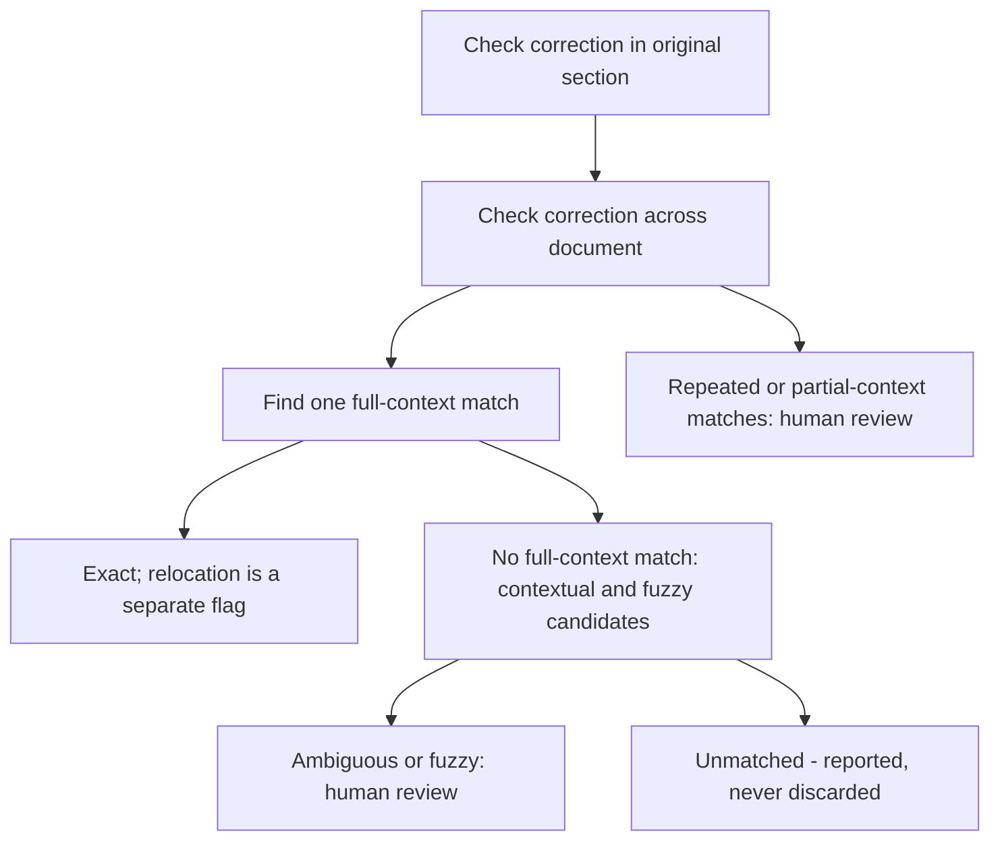

# Markdown Annotator

Leave comments and suggested edits on a Markdown file without touching the
prose, and keep them with the file.

If you have ever reviewed a document by pasting quotes into chat ("in the third
paragraph of *Known issues*, change 'adressed' to 'addressed'"), you know the
problem. The feedback lives somewhere else than the text, it goes stale the
moment someone edits the file, and nobody can tell which notes were already
handled. This project puts the feedback *in* the document, in a form that both
people and tools can read.

## What's in here

| Path | What it is |
| --- | --- |
| [simple-editor/index.html](simple-editor/index.html) | A single-file editor you can open in a browser. No install, no build. |
| [SPECIFICATION.md](SPECIFICATION.md) | The rules: where annotations are stored and how they are found again after edits. |
| [schema.json](schema.json) | The JSON Schema the annotation payload must satisfy. |

## Try it in two minutes

The browser editor reads and writes version 2.0.0 payloads. It rejects version
1 payloads rather than migrating them. Its browser-only resolver is intended for
review, not unattended application of text edits.

1. Open [simple-editor/index.html](simple-editor/index.html) in a browser
   (double-click it, or drag it onto a browser window).
2. A sample document loads. Select any text in the rendered view.
3. A small popup appears: **Comment**, **Reword**, **Add**, **Delete**. Pick one,
   fill in the form on the right, save the annotation.
4. Click **Save .md (embedded)** to download the document with your annotations
   appended, or **Save .annotations** for a separate file.

To review your own file, drag a `.md` or `.mdx` onto the page. Drag a
`.annotations` file on top of it to load existing feedback. Your work is kept in
browser local storage, so a reload won't lose it; **Reset storage** clears it and
brings back the sample.

## Export an annotated PDF

Click **Download annotated PDF** to save a PDF with selectable text and native
highlight annotations containing comments and proposed edits. Open the PDF in a
reader with annotation support to inspect the comments. Open entries are included;
addressed and deleted entries are excluded. Unmatched, ambiguous, and otherwise
unrendered selections are listed in an appendix. Fuzzy anchors are labeled for review.

Export works offline, including when opening the editor directly from disk. PDF-lib
1.17.1, fontkit 1.1.1, and Noto Sans are bundled locally in `simple-editor/lib/`;
no CDN or upload is used. The PDF uses a separate text layout: tables become text
rows, Mermaid diagrams export as source, and inline bold/italic styles are not
preserved. Noto Sans covers common Latin, Greek, and Cyrillic text; unsupported
glyphs appear as `?` in page text (native comment contents retain Unicode).

PDF export regression checks use a test-only `jsdom` installation: run
`node tests/test_pdf_export.cjs` with `jsdom` available on Node’s module path.

## The four things you can say

| Operation | Means | Changes the document? |
| --- | --- | --- |
| `comment` | "Here's a thought about this passage." | No |
| `reword` | "Replace this with that." | Yes |
| `add` | "Insert this text here." | Yes |
| `delete` | "Remove this." | Yes |

A `comment` is a conversation. The other three are concrete proposals that a
person or an agent can apply. Text edits may also carry an optional `comment`
with the rationale for the change.

An `add` inserts its `value` after the selected text by default; set
`selection.placement` to `before` to insert before it. The value is copied
verbatim, so include any desired spaces or line breaks in the value itself. An
empty `selection.text` marks an insertion point only at the document's start or
end and requires both context fields; a present-empty context asserts the
corresponding boundary. For an empty document, both context fields are present
and empty:

```json
{"operation":"add","selection":{"text":"","prefix":"","suffix":""},"value":"Start here."}
```

This inserts `Start here.` at the document's only position.

## Where the annotations live

Two options, same JSON either way.

**Embedded** — appended to the end of the Markdown file, after a `---`
separator, inside a fenced `json:annotation` block:

````markdown
# My document

The actual content.

---
```json:annotation
{
  "$schema": "urn:markdown-annotation:document-comments:2.0.0",
  "schemaVersion": "2.0.0",
  "createdAt": "2026-10-10T12:00:00Z",
  "updatedAt": "2026-10-10T12:00:00Z",
  "entries": []
}
```
````

This is the default, because the feedback travels with the file through email,
Git, and copy-paste. A Markdown renderer that knows the extension hides the
block; one that doesn't shows it as a code block.

**Sidecar** — a separate file next to the document, named by *appending*
`.annotations` to the full filename:

```text
README.md        ->  README.md.annotations
Component.mdx    ->  Component.mdx.annotations
```

Use this when the document itself must stay untouched. If both exist, the
embedded block wins and the mismatch is reported — never silently merged.

## Why annotations survive edits

The hard part isn't storing feedback, it's finding the right spot again after
the document has moved on. Line numbers break immediately. So each entry
records what it points at, plus the text just before and just after it, plus the
heading it lived under.

Before looking for text to change, a consumer checks whether the requested
result is already present at the original contextual location. If the paragraph
has moved to another section and the correction is not found there, it checks
the full document using the same context. These checks make applying the same
annotation repeatedly safe, even if the old wording still appears elsewhere.
If the change is not already present, the consumer looks for the selected text,
first in its original section and then across the document. The selected text
must fit within its candidate section, while before/after context can cross
section boundaries. An empty section heading means the whole document; producers
use it when no one heading contains the full selection:



If someone already fixed the typo, the original text is gone — but that's
success, not failure. The tool checks whether the suggested result is now
sitting at the recorded contextual location and marks the entry as handled.
An old occurrence elsewhere in the document does not stop this check.

Every result has one state: `exact`, `fuzzy`, `applied`, `ambiguous`, or
`unmatched`. A separate Boolean `relocated` reports whether the saved section
could not constrain the result; it does not replace or change the state. One
literal source equality of the selected text and complete contexts is required
for `exact`. Normalized-only matches require review. Repeated or partial-context
candidates are `ambiguous` and need human review; `fuzzy` candidates also need
confirmation. A source candidate may be applied only after review; a completion
candidate may be confirmed as already handled and must never be applied again.
Only an exact result with `relocated=false` is safe to apply unattended.

## Nothing is ever thrown away

Each entry keeps an append-only timeline of events — created, submitted,
addressed, unmatched, deleted. Addressed entries pause until explicitly
reopened with `submitted`; deleted entries remain in history and are terminal.
Resolving an entry is read-only; a writer records a result by appending an event.
Tick **show deleted** in the editor to see deleted annotations again.

This is deliberate. In a review you want to know what was asked, what was done
about it, and what was dropped on purpose.

## For tool builders

If you're writing something that reads or writes these annotations — an
extension, a linter, an agent — read [SPECIFICATION.md](SPECIFICATION.md). It is
normative, with a conformance checklist at the end. The short version:

- Validate against [schema.json](schema.json); reject unknown `schemaVersion`
  values rather than guessing, including v1 `1.0.0` unless migration was
  explicitly requested.
- Run the schema contract checks with `python3 -m unittest discover -s tests`
  (requires the Python `jsonschema[format]` package extra).
- Treat the payload as data. Never execute or render values from it.
- Preserve properties you don't understand when rewriting.
- Don't fall back to the sidecar when an embedded block is broken. Report it.

## Status

Specification version 2.0.0, schema version 2.0.0. The editor in
[simple-editor/](simple-editor/index.html) creates and loads v2 payloads and
keeps everything on your machine. It is a review playground, not a fully
conforming v2 consumer: it does not implement the complete normalization and
heading-resolution algorithm, duplicate JSON-key detection, or automatic
sidecar discovery. Use a conforming consumer for unattended edits.
