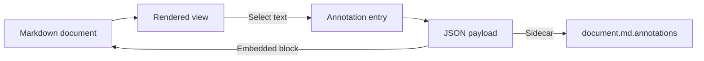

# Release Notes: Annotation Extension

The annotation extension associates a Markdown document with one JSON payload.
It supports **embedded** blocks and *sidecar* files.

## Goals

- Keep review requests next to the content they describe.
- Survive edits through prefix and suffix anchors.
- Never silently discard an entry, because the payload is append-only.

## Usage

Select any text in this rendered view and choose an operation from the popup.
Use `Save .md (embedded)` to download the document with the payload appended,
or `Save .annotations` to download a sidecar file.

> Annotations are stored as source offsets, not DOM positions, so they can be
> resolved again after the document has changed.

## Workflow



## Operations

| Operation | Kind | Requires | Modifies the document |
| --- | --- | :---: | ---: |
| `comment` | comment | `comment` | no |
| `delete` | text-edit | `selection` | yes |
| `add` | text-edit | `selection`, `value` | yes |
| `reword` | text-edit | `selection`, `value` | yes |

## Known issues

The resolution algorithm currently reports a fuzzy match without asking for
confirmation. This will be adressed in the next release.


---
```json:annotation
{
  "$schema": "urn:markdown-annotation:document-comments:2.0.0",
  "schemaVersion": "2.0.0",
  "createdAt": "2026-10-15T05:36:08Z",
  "updatedAt": "2026-10-15T05:57:21Z",
  "entries": [
    {
      "id": "eac6f664-8313-46d8-98b4-bb2dc038370a",
      "kind": "comment",
      "operation": "comment",
      "createdAt": "2026-10-15T05:36:51Z",
      "section": {
        "heading": "Goals",
        "text": "Goals\n\n- Keep review requests next to the content they describe.\n- Survive edits through prefix and suffix anchors.\n- Never silently discard an entry, because the payload is append-only."
      },
      "selection": {
        "text": "content they describe",
        "prefix": "supports **embedded** blocks and *sidecar* files.\n\n## Goals\n\n- Keep review requests next to the ",
        "suffix": ".\n- Survive edits through prefix and suffix anchors.\n- Never silently discard an entry, because "
      },
      "events": [
        {
          "eventId": "8e5ab8dc-2dca-49fc-a774-c93743a75d19",
          "type": "created",
          "timestamp": "2026-10-15T05:36:51Z"
        }
      ],
      "comment": "I do not understand what content means here"
    },
    {
      "id": "17edbf48-bb0b-48a9-8ace-1cb47b4899d2",
      "kind": "text-edit",
      "operation": "reword",
      "createdAt": "2026-10-15T05:37:26Z",
      "section": {
        "heading": "Goals",
        "text": "Goals\n\n- Keep review requests next to the content they describe.\n- Survive edits through prefix and suffix anchors.\n- Never silently discard an entry, because the payload is append-only."
      },
      "selection": {
        "text": "payload",
        "prefix": "Survive edits through prefix and suffix anchors.\n- Never silently discard an entry, because the ",
        "suffix": " is append-only.\n\n## Usage\n\nSelect any text in this rendered view and choose an operation from t"
      },
      "events": [
        {
          "eventId": "da8033be-5a91-45a0-8fbc-1ae119275aec",
          "type": "created",
          "timestamp": "2026-10-15T05:37:26Z"
        }
      ],
      "comment": "payload is not optimal here",
      "value": "changes"
    },
    {
      "id": "0e00f84e-e49b-4337-babb-6e42ef180ea4",
      "kind": "text-edit",
      "operation": "add",
      "createdAt": "2026-10-15T05:37:55Z",
      "section": {
        "heading": "Usage",
        "text": "Usage\n\nSelect any text in this rendered view and choose an operation from the popup.\nUse `Save .md (embedded)` to download the document with the payload appended,\nor `Save .annotations` to download a sidecar file.\n\n> Annotations are stored as source offsets, not DOM positions, so they can be\n> resolved again after the document has changed."
      },
      "selection": {
        "text": "operation",
        "prefix": "ause the payload is append-only.\n\n## Usage\n\nSelect any text in this rendered view and choose an ",
        "suffix": " from the popup.\nUse `Save .md (embedded)` to download the document with the payload appended,\no",
        "placement": "after"
      },
      "events": [
        {
          "eventId": "d8f345e0-27b8-4002-ade2-1b88fa912aff",
          "type": "created",
          "timestamp": "2026-10-15T05:37:55Z"
        }
      ],
      "value": " (comment, reword, add, delete)"
    },
    {
      "id": "abd16544-5601-4cb1-81e2-677f4a6aafdc",
      "kind": "comment",
      "operation": "comment",
      "createdAt": "2026-10-15T05:38:16Z",
      "section": {
        "heading": "Operations",
        "text": "Operations\n\n| Operation | Kind | Requires | Modifies the document |\n| --- | --- | :---: | ---: |\n| `comment` | comment | `comment` | no |\n| `delete` | text-edit | `selection` | yes |\n| `add` | text-edit | `selection`, `value` | yes |\n| `reword` | text-edit | `selection`, `value` | yes |"
      },
      "selection": {
        "text": "selection",
        "prefix": "| --- | --- | :---: | ---: |\n| `comment` | comment | `comment` | no |\n| `delete` | text-edit | `",
        "suffix": "` | yes |\n| `add` | text-edit | `selection`, `value` | yes |\n| `reword` | text-edit | `selection"
      },
      "events": [
        {
          "eventId": "477256fb-6302-4493-8653-7a7bdff6ae3c",
          "type": "created",
          "timestamp": "2026-10-15T05:38:16Z"
        }
      ],
      "comment": "It also works in tables"
    },
    {
      "id": "101b3aa1-adeb-4543-88b4-0113bf26dfa5",
      "kind": "text-edit",
      "operation": "delete",
      "createdAt": "2026-10-15T05:57:17Z",
      "section": {
        "heading": "Known issues",
        "text": "Known issues\n\nThe resolution algorithm currently reports a fuzzy match without asking for\nconfirmation. This will be adressed in the next release."
      },
      "selection": {
        "text": "resolution",
        "prefix": "n`, `value` | yes |\n| `reword` | text-edit | `selection`, `value` | yes |\n\n## Known issues\n\nThe ",
        "suffix": " algorithm currently reports a fuzzy match without asking for\nconfirmation. This will be adresse"
      },
      "events": [
        {
          "eventId": "69483d57-f0d0-4964-9bf6-fc2814121481",
          "type": "created",
          "timestamp": "2026-10-15T05:57:17Z"
        }
      ]
    }
  ]
}
```
